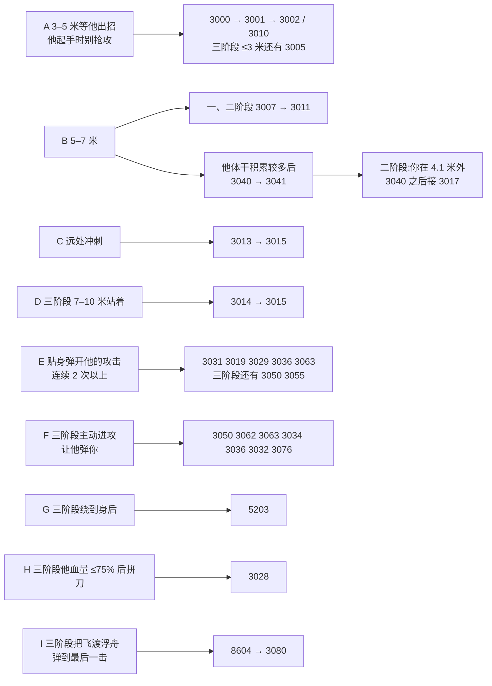

# 第二轮录像指南：天守阁弦一郎（原版 1.06）

这份指南用在第二轮录像（计划第 6 步：定向补录）。范围和 v4.0.0 一致，只录天守阁的 3 个阶段。

先看下面的**补录清单**：它按你审核通过的招式目录（`semantic/genichiro_catalog.md`）列出还缺录像证据的招式，分批排好。后面的"打法清单"是每种打法的详细条件，清单里的字母 A–I 指向它们。

**依据**：

- 第一轮录像，2026-10-09，数据在 `observations/vanilla/genichiro/2026-10-09-castle/`；
- 天守阁 AI 的可达性表 `engine/genichiro_castle_ai_reachability.csv` 和流程图 `engine/genichiro_castle_ai.md`。

这几个文件目前在 `feature/ground-truth-genichiro` 分支上。

下面的条件都是从反编译的战斗 AI 里读出来的。标着 **推测** 的是对条件含义的解释，没有直接证据，需要你在游戏里验证；标着 **已确认** 的是你在 2026-10-12 确认过的。百分比按 AI 的权重粗算，只表示相对机会。

## 补录清单（按招式目录，2026-10-13）

目录里 63 个招式全部经你审核通过，其中 25 个缺录像证据：一、二阶段 9 个，三阶段 16 个。

**进度（2026-10-13 的录像之后）**：录到了 6 个，都在三阶段，下表里标 ✅ 的就是。还缺 19 个：一、二阶段 9 个，三阶段 10 个。录像的核对结果见 `observations/vanilla/genichiro/2026-10-13-castle/`（`feature/ground-truth-genichiro` 分支）。

每个招式录到一次完整的动作链就够了：

- 保留前摇、连段和收招；
- 适当包含被命中、崩躯干或死亡的情况，以后验证失败归因会用到。

侧移 5202、5203 不算招式，不用专门录。

### 第一批：飞渡浮舟第一套和它的分支

| 条目 | 招式 | 阶段 | 还缺的动画 | 怎么引出 |
|---|---|---|---|---|
| P12-22 | 飞渡浮舟第一套 3040 → 3041 | 一、二 | 3040、3041 | B：3–7 米，不冲刺，先把他体干打到一半左右（体干剩余 ≤ 360）。一阶段 3040 后一定接 3041；二阶段 3040 快结束时要在 4.1 米内 |
| P12-14 | 射箭取消 3017（飞渡浮舟的衍生 floating-passage-cancel） | 二 | 3017 | B：二阶段 3040 快结束（约 3.3 秒）时退到 4.1 米外 |
| ✅ P3-20 | 飞渡浮舟第一套 3040 → 3041 → 3067 | 三 | 已录到（2026-10-13，两次） | B：5–7 米最容易（约 40%）；3040 快结束时要在 5.5 米内才接 3041 |

### 第二批：三阶段（多待在三阶段）

| 条目 | 招式 | 阶段 | 还缺的动画 | 怎么引出 |
|---|---|---|---|---|
| P3-01 | Act01 连段 3000 → 3001 → 3002 → 3003，或 → 3010 → 3025 | 三 | 3002、3003、3010 | A：3–5 米或 3 米内；他起手后只防不攻，也别后退（留在 3.4 米内） |
| ✅ P3-03 | 3005 | 三 | 已录到（2026-10-13，三次） | A：3 米内；他刚出过 3039、3042 或 3043 的 15 秒内更容易 |
| P3-09 | 3013 → 3015 | 三 | 3013、3015 | C：5 米外冲刺 |
| P3-10 | 3014 → 3015 | 三 | 3014、3015 | D：7–10 米站着，不冲刺 |
| P3-18 | 飞渡浮舟第三套 3028 | 三 | 3028 | H：把他打到 75% 血量以下后拼刀 |
| ✅ P3-30 | 飞渡浮舟完美弹完后的突刺 3080 | 三 | 已录到（2026-10-13，两次：8604 和 8704 之后） | I：任意一套飞渡浮舟一路弹到最后一击 |
| P3-24、P3-25、P3-29、P3-11、P3-15、P3-16（✅ P3-23 3050、P3-26 3063、P3-17 3032 已录到） | 拼刀后的反应：3055、3062（危·突刺）、3076、3034 → 3036 → 3015、3029 | 三 | 3055、3062、3076、3034、3036、3015、3029 | E、F：贴身弹开他，也主动进攻让他弹你（1 秒内连砍两刀，第二刀一定是强弹 3101）。多待在三阶段就会陆续出现 |

### 第三批：一、二阶段的其他招式

| 条目 | 招式 | 阶段 | 还缺的动画 | 怎么引出 |
|---|---|---|---|---|
| P12-06 | Act34 3007 → 3011 | 一、二 | 3007、3011 | B：5–7 米等他出招 |
| P12-09 | 3013 → 3015 | 一、二 | 3013 | C：7 米外冲刺 |
| P12-12、P12-15、P12-16 | 拼刀后的 3031、3019、3029、3036 | 一、二 | 3019、3029、3031、3036 | E：贴身连续弹开他 2 次以上 |
| P12-01 | Act01 连段 | 一、二 | 3000、3001、3002、3010 | A：3–5 米，别打他体干；他起手后只防不攻，留在 3.4 米内。激进拼刀时几乎不出 |

### 之后：极低概率

| 条目 | 招式 | 阶段 | 还缺的动画 | 怎么引出 |
|---|---|---|---|---|
| P12-27 | 飞渡浮舟第二套的另一种起手 3063 | 一、二 | 3063 | E：拼刀计数 ≥ 2 后弹开他，约 2% |

录完后，Claude 会把录到的动画补进目录的证据栏，并截取带时间标签的参考片段。

## 按动画的目标（第一轮之后的统计）

天守阁 AI 能请求、但第一轮没录到的动画共 38 个，其中攻击和飞行物 35 个：

| 角色 | 阶段 | 攻击 | 飞行物 | 其他 |
|---|---|---|---|---|
| c7100 | 一、二阶段 | 3000 3001 3002 3007 3010 3019 3029 3040 3041 3063 | 3011 3013 3017 3031 3036 | 5202 5203 |
| c7110 | 三阶段 | 3002 3003 3005 3010 3015 3028 3029 3032 3040 3041 3050 3055 3062 3063 3076 3080 | 3013 3014 3034 3036 | 5203 |

AI 从不请求的动画（`not_reachable`）不用去录。它们仍然留在 ground truth 里，之后分类。

## 最重要的一条：三阶段要多录

第一轮各阶段的时长：

| 阶段 | 时长 |
|---|---|
| 一阶段 | 约 179 秒 |
| 二阶段 | 约 92 秒 |
| 三阶段 | 约 86 秒（最后死了） |

38 个目标里有 21 个在三阶段。三阶段和一、二阶段用的是同一套拼刀反应逻辑，只是录得太短：

- 一、二阶段里，拼刀后的 3050、3055、3076 分别出现了 5、4、28 次；
- 三阶段里一次都没有。

所以只要在三阶段多待，就能补到不少。建议三阶段累计录 5 分钟以上，可以分几次尝试。

## 录制设置

和第一轮一样：

- 开发者菜单开着，"Active Anime"列表的位置不变；
- 2560×1440，60 fps；
- Resurrection 关闭；
- 死亡和重来也一直录着。

每段录像记下：日期、游戏版本、Resurrection 关闭、打到了哪个阶段。

## 打法清单

### A　3–5 米等他出招，他起手时别抢攻

**目标**：

- 一、二阶段：3000、3001、3002、3010；
- 三阶段：3002、3003、3010；≤3 米时还有 3005。

**依据**：这几招都在同一个选项 Act01 里：3000 → 3001 → 然后二选一：

- 3002 → 3003：一、二阶段 30%，三阶段 70%；
- 3010 → 3025：一、二阶段 70%，三阶段 30%。

Act01 的权重很小，3–5 米时约 7%。有两种情况会高一些：

- 一、二阶段：他体干积累还少时，Act09 不参与，Act01 的比例更高；
- 三个阶段：你冲刺时，任何距离都会给 Act01 加一点权重；
- 三阶段：他刚用过 3039、3042 或 3043 后的 15 秒内，这几招暂时不选。这时 ≤3 米的 Act01 和 Act03（3005）各约 25%。

**第一轮的教训**：三阶段 Act01 起手了 5 次：

- 4 次是你在他刚出 3000 时进攻，他在 3–5 帧内弹刀（3100），整串被打断；
- 另外 1 次出到 3001 就停了。

所以他起手时，用防御或弹刀让他把整串打完，不要抢攻。

### B　5–7 米

**一、二阶段 3007 → 3011**（Act34）：5–7 米时约 12–20%。

**3040 → 3041**（Act09）：

- 条件：3–7 米、你没在冲刺、距上次 Act09 超过冷却时间（一、二阶段 30 秒，三阶段 20 秒），并且：
  - 一、二阶段：他的 SP ≤ 360。SP 是体干剩余值（**已确认**），上限 660，所以这时他的体干条已经积累了约 45% 以上。
  - 三阶段：只有 ≤3 米时需要 SP 比例 ≤ 0.75，即体干条积累了 25% 以上。3–7 米没有体干条件。
- 这是飞渡浮舟的第一种出法，详见下面的"飞渡浮舟的三种出法"。
- 满足条件时的比例：一、二阶段 3–5 米约 80%，三阶段 5–7 米约 40%，三阶段 ≤3 米约 79%。
- **距离会改变后续**：
  - 一阶段：3040 之后总是接 3041。
  - 二阶段：3040 播到约 3.3 秒（接近结束）时会给他加一个触发特效。这时你在 **4.1 米外**，他改出 **3017**；在 4.1 米内才接 3041。所以二阶段两种距离都要录。
  - 三阶段：3040 → 3041 → 3067。3040 播到约 3.3 秒时也会加一个触发特效：这时你在 5.5–11 米，他改出 3008（已录到）；11 米外改出 3018。所以想录 3041，3040 快结束时要在 **5.5 米内**。

**3017 的另一条路**：二阶段他的 3092 播到约 2.7 秒时，你在 4.1 米外，也会接 3017。3092 是你弹开他的 3063 或 3068 之后，他接的反击。

### C　远处冲刺

**目标**：3013 → 3015（Act48），三个阶段都有。

**依据**：只有在你冲刺时（玩家特效 109900「ダッシュ中_敵AI参照」，冲刺中，**已确认**）才会选 Act48：

- 一、二阶段 ≥7 米约 37%；
- 三阶段 ≥5 米约 40%。

3013 借用 3014 的动画，画面列表里显示的是 3013。

### D　三阶段 7–10 米站着不动（不冲刺）

**目标**：3014 → 3015（Act15）。

**依据**：约 8%；他刚用过 3039、3042 或 3043 后的 15 秒内约 14%。≥10 米时他主要出 3008（已录到）。

### E　贴身弹开他的攻击，连续 2 次以上（距离 < 2.5 米）

**计数**：AI 有一个拼刀计数。

- 加 1：你弹开他的攻击（一、二阶段只在其中一个方向 200200 时加）；或者他弹开你的攻击，且距离很近（一、二阶段 < 2 米，三阶段 < 3 米）。
- 清零：他出完某些大招，如 3025、3028、3032、3040、3041、3062、3067、3092；或者被忍杀。
- 计数到 2 以上，拼刀后的选项才会变多。

**一、二阶段**，计数 ≥ 2 时你弹开他：

| 选项 | 动画 | 比例 |
|---|---|---|
| Kengeki15 | 3031 → 3019 → 3029（50%），或 3031 → 3036（50%） | 约 11–12% |
| Kengeki39 | 3034 → 3036 → 3015 | 约 11–12% |
| Kengeki33 | 3018 → 3019，50% 再接 3029 | 约 8–18% |
| Kengeki30 | 3063 | 约 2%，很少 |

- Kengeki33 和 Kengeki32（3018 → 3015，已录到）轮流出现。
- 第一轮里 3034 出过 1 次，但没接到 3036 就断了。

**三阶段**：

- 计数 < 2 时你弹开他：总是出 **3050**。三阶段 AI 不会切换到 3055 的那个分支。
- 计数 ≥ 2 时，Kengeki32（3018 → 3043）和 Kengeki33（3018 → 3019 → 3029）轮流出现。拼刀方向是 200201 时，这两个合计约 80%，另有 3031 开头的 Kengeki15 约 5%；方向是 200200 时合计约 18%，另有 3063 约 5%。方向由他的出招决定，你控制不了。
- 3055 只来自"他被弹开·弱（左）"这种拼刀类型（200206）。它对应游戏里的什么操作还没确定，多弹刀就有机会。

### F　三阶段主动进攻，让他弹你

他弹开你时会出 3100（"弱"）或 3101（"强"）。规则在公用 AI 脚本里：

- 他每次弱弹开你，"连续格挡数"加 1；只有在上一次的 1 秒内才累加，否则从 1 重新算。强弹开后清零。
- 出 3101 的概率 = 连续格挡数 × 100%。

所以你第一刀被弹，他出 3100；**1 秒内再砍一刀，他一定出 3101**。

**他出 3100（"弱"）之后**：

- 计数 < 2：3050 和 5202 → 3007 各约 17–25%，其余是正常选招或 3039。
- 计数 ≥ 2：可能出这些：
  - 3063，在 200216 这种类型下约 18%；
  - 3062；
  - 3067；
  - 3034 → 3036 → 3015；
  - 3031 开头的 Kengeki15；
  - 3030 → 3067、3025 或 **3032**，各约三分之一。

**他出 3101（"强"）之后**：

- **3076**（Kengeki17），一种类型下约一半；
- 3068，即飞渡浮舟的第二种出法的开头，见下面；
- 3030 → 3067、3025 或 3032。

**证据**（第一轮一、二阶段）：

- 只在"他弹开你·强"类型下才会出的 3071（5 次）和 3065（7 次），前面都是 3101 → 8400/8401；
- 只在"他弹开你·弱"类型下才会出的 3076（28 次），前面都是 3100 → 8500/8501；
- 只在"他被你弹开"类型下才会出的 3055（4 次），前面都是 8601。

这和社区参数名一致：200210/200211/200215/200216 是「弾いた」（他弹开了你），200200/200201 是「弾かれた」（他被弹开）。社区名只作参考，证据是上面的先后顺序。

### G　三阶段绕到他身后

**目标**：5203。

**依据**：你在他身后半圈时，他约一半概率选 Act22（侧移），出 5202（已录到）或 5203。

- 他左右两侧都有 2 米空间时：你在他右侧出 5202，在左侧出 5203。
- 左右的对应关系**已确认**。

一、二阶段的 Act22 权重只有 1，约 1%，不值得专门录。

### H　三阶段他血量 ≤ 75% 之后拼刀

**目标**：3028（Kengeki40），飞渡浮舟的第三套（**已确认**），见下面。

**依据**：每次拼刀都会加上这个选项（权重 50）。条件：

- 他的 HP 比例 ≤ 0.75；
- 距他上次 3040 超过 20 秒；
- 距上次 3028 或 3092 超过 50 秒。

### I　三阶段：把飞渡浮舟弹到最后一击 → 8604 → 3080

**已确认**：8604 是飞渡浮舟最后一下完美弹开之后他的动作；三阶段之后固定出突刺 3080。

**代码**：8604 播到约 1 秒时给他加特效 5030。三阶段的 AI 收到 5030，就立即出 **3080**（100%）。一、二阶段的 AI 不处理 5030。

**第一轮录像**：8604 出现过 3 次，都在一阶段，都紧跟在一串 9600/9700 之后。9600/9700 是他被弹开后的罚站（**已确认**），会加特效 3710030（AI 中断判定：被弹开加算）。

| 前面的招 | 帧 | 8604 的帧 | 录像时间 |
|---|---|---|---|
| 3092 | 1342 | 1578 | 22.4–26.3 秒 |
| 3028 | 6399 | 6676 | 106.7–111.3 秒 |
| 3028 | 9434 | 9713 | 157.3–161.9 秒 |

所以三阶段里，下面三种飞渡浮舟的任何一种，弹到最后一击都可能接 3080。第一轮三阶段的那次 3092，你弹了 5 下后没有出 9700，之后不久三阶段的录像就结束了。

## 飞渡浮舟的三种出法

飞渡浮舟共有三套（**已确认**）：3040 + 3041、3068 + 3092、3028。

| 出法 | 动画 | 怎么触发 | 和体干的关系 |
|---|---|---|---|
| 一 | 3040 → 3041（三阶段再接 3067） | 他主动选招（Act09）：3–7 米，你没在冲刺 | 一、二阶段：体干剩余 ≤ 360 才会选；三阶段只有 ≤3 米时要求体干剩余 ≤ 75% |
| 二 | 3068（或 3063）→ 3092 | 他强弹开你之后选 3068；你弹开 3068 的第二刀，他才接 3092 | 无 |
| 三 | 3028 | 任何拼刀之后都可能选（Kengeki40） | 无，看的是 HP ≤ 75% |

**三套的共同点**：7 击用的是同一组攻击判定，顺序完全一样：

| 动画 | 击数 | 攻击判定 ID（按顺序） | 第一击 |
|---|---|---|---|
| 3040 + 3041 | 4 + 3 | 290 291 291 290 ＋ 291 290 292 | 1.97 秒 |
| 3092（借用 8603） | 7 | 290 291 291 290 291 290 292 | 1.27 秒 |
| 3028 | 7 | 290 291 291 290 291 290 292 | 1.97 秒 |

第一轮里，3028 被弹到最后之后也出了 8604（两次）。你确认 3028 是完整的一套飞渡浮舟。

### 第一种：3040 → 3041（Act09）

- **一、二阶段**：只有体干剩余 ≤ 360（满值 660，体干条积累约 45% 以上）时，AI 才把 Act09 加进候选，权重 300。3–5 米时约 80%，5–7 米约 37%。体干剩余 > 360 时完全不会选。
- **三阶段**：5–7 米约 40%，3–5 米约 20%，不看体干；≤3 米时只有体干剩余 ≤ 75% 才加入，约 79%。
- 他会先走到约 4.5 米再起手。
- 3040 播到约 3.3 秒时，你的距离决定后续，见 B 打法。
- 第一轮一次都没出现。

### 第二种：3068 → 3092

1. 你砍他，他弱弹开（3100）。
2. 1 秒内再砍，他一定强弹开（3101）。
3. 强弹开之后的选招里，3068 一、二阶段约 14–20%，三阶段约 25–50%。另一条少见的路：拼刀计数够高后（一、二阶段 ≥ 3，三阶段 ≥ 2）他弱弹开你，约 7–13%。3063 和 3068 的两刀完全一样，也能接 3092。
4. 3068 有两刀，在 0.93 秒和 1.30 秒。第二刀时，他身上有一个只持续约 0.1 秒的特效 3710032。你弹开第二刀，他罚站并加上 3710030；AI 看到两个特效同时存在，就改出 3092。
5. 二阶段：3092 播到约 2.7 秒时，你在 4.1 米外，他改出 3017。

AI 在拼刀选招时读取了体干，但没有用到，所以这一种和体干无关。

**第一轮录像里的 10 次 3068**：

- 9 次前面是 3101 → 8400/8401（强弹开），1 次是 3100 → 8501（三阶段，计数够高后的弱弹开）。
- 6 次你两刀都弹开了，第二次弹开后约 0.03–0.05 秒就出了 3092。
- 另外 4 次没有 3092：
  - 1 次你没有弹；
  - 2 次你在 3068 中途出刀，被他弹开；
  - 1 次在弹开的过程中他体干崩了，直接进入忍杀。

### 第三种：3028（Kengeki40）

每次拼刀后，只要他 HP ≤ 75%、而且共用冷却已过，就加入候选，权重 50。第一轮一阶段出了 2 次。

### 共用冷却

三种出法共用 AI 计时器 6：

| 出完 | 冷却 |
|---|---|
| 3040（一、二阶段） | 30 秒 |
| 3040（三阶段） | 20 秒 |
| 3092 | 50 秒 |
| 3028 | 50 秒 |

计时器 6 没到时，第一种和第三种都不会被选。第二种不受影响：3068 照样能出，弹开第二刀照样接 3092。

## 逐个动作对照表

"打法"一列对应上面的字母。

### c7100（一、二阶段，AI 710000）

| 动画 | 类别 | AI 选项 | 条件（大意） | 打法 |
|---|---|---|---|---|
| 3000、3001 | 攻击 | Act01 | 3–5 米，约 7%；冲刺时任何距离都有少量机会 | A |
| 3002 | 攻击 | Act01 | 3000 → 3001 之后 30% | A |
| 3010 | 攻击 | Act01 | 3000 → 3001 之后 70% | A |
| 3007 | 攻击 | Act34 | 5–7 米，约 12–20% | B |
| 3011 | 飞行物 | Act34 | 接在 3007 后 | B |
| 3040 | 攻击 | Act09 | 3–7 米，SP ≤ 360，30 秒冷却，不冲刺 | B |
| 3041 | 攻击 | Act09 | 接在 3040 后；二阶段 3040 快结束时要在 4.1 米内 | B |
| 3017 | 飞行物 | 打断 | 仅二阶段：3040 或 3092 快结束时你在 4.1 米外 | B |
| 3013 | 飞行物 | Act48 | 你冲刺时 | C |
| 3019、3029 | 攻击 | Kengeki15、Kengeki33 | 拼刀计数 ≥ 2 后弹开他 | E |
| 3031 | 飞行物 | Kengeki15 | 同上 | E |
| 3036 | 飞行物 | Kengeki15、Kengeki39 | 同上 | E |
| 3063 | 攻击 | Kengeki30 | 同上，约 2% | E（少见） |
| 5202、5203 | 其他 | Act22 | 你在他身后，约 1% | G（少见） |

### c7110（三阶段，AI 711000）

| 动画 | 类别 | AI 选项 | 条件（大意） | 打法 |
|---|---|---|---|---|
| 3002、3003 | 攻击 | Act01 | 3000 → 3001 之后 70% | A |
| 3010 | 攻击 | Act01 | 3000 → 3001 之后 30% | A |
| 3005 | 攻击 | Act03 | ≤3 米，约 6%（冷却期最高约 25%），7 秒冷却 | A |
| 3040、3041 | 攻击 | Act09 | 3–7 米，20 秒冷却；想看到 3041，3040 快结束时要在 5.5 米内 | B |
| 3013 | 飞行物 | Act48 | 你冲刺时，≥5 米约 40% | C |
| 3014 | 飞行物 | Act15 | 7–10 米，不冲刺，约 8–14% | D |
| 3015 | 攻击 | Act15、Act48、Kengeki39 | 接在 3013 或 3014 之后 | C、D |
| 3050 | 攻击 | Kengeki01 | 拼刀计数 < 2 时的拼刀，应该很常见 | E、F |
| 3055 | 攻击 | Kengeki04 | 只在拼刀类型 200206 时出现 | E |
| 3029 | 攻击 | Kengeki15、Kengeki33 | 计数 ≥ 2 后弹开他 | E |
| 3034 | 飞行物 | Kengeki39 | 计数 ≥ 2 后他弹开你 | F |
| 3036 | 飞行物 | Kengeki15、Kengeki39 | 同上 | E、F |
| 3062 | 攻击 | Kengeki43 | 计数 ≥ 2 后他弹开你 | F |
| 3063 | 攻击 | Kengeki30 | 计数 ≥ 2 后的拼刀 | E、F |
| 3032 | 攻击 | Kengeki38 | 3030 之后约三分之一 | F |
| 3076 | 攻击 | Kengeki17、Kengeki14 | 他出 3101 弹开你之后；或拼刀类型 200206 | F、E |
| 3028 | 攻击 | Kengeki40 | 他 HP ≤ 75% 后的拼刀 | H |
| 3080 | 攻击 | 打断 | 他出 8604 时，100% | I |
| 5203 | 其他 | Act22 | 你在他身后左侧 | G |

## 已确认（2026-10-12）

1. 8604 是飞渡浮舟最后一下完美弹开之后的动作；三阶段之后固定出突刺 3080。
2. 9600/9700 是他被弹开后的罚站，带特效 3710030（AI 中断判定：被弹开加算）。
3. 109900 是冲刺（「ダッシュ中_敵AI参照」）。
4. SP 是体干剩余值。
5. 3028 是完整的一套飞渡浮舟，所以飞渡浮舟共有三套。
6. G 打法：他两侧都开阔时，你在他左侧，他出 5203。

## 录完之后

告诉 Claude 录像路径。Claude 会：

1. 运行提取管线，复查所有被标记的帧；
2. 把新录到的动画补进覆盖率表；
3. 把这份指南里的推测和录像对照，看是否成立。
